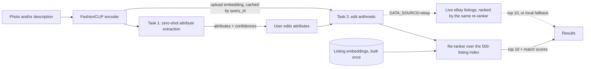

# AI model

**Owner:** Member A (ML Lead) · **Backlog:** S3-8 · **Results:** [`EVALUATION.md`](EVALUATION.md)

Thrift Searcher uses one pretrained vision-language model, FashionCLIP, for two AI tasks: reading
a jacket's attributes from a photo (Task 1) and finding listings that match the photo after the user
edits those attributes (Task 2). The model runs locally on the CPU; no external AI API is called.



## Model

| | Primary | Baseline |
|---|---|---|
| Model | FashionCLIP, [`patrickjohncyh/fashion-clip`](https://huggingface.co/patrickjohncyh/fashion-clip) | CLIP ViT-B/32, [`openai/clip-vit-base-patch32`](https://huggingface.co/openai/clip-vit-base-patch32) |
| What it is | CLIP fine-tuned by its authors on fashion product images and descriptions | General-purpose CLIP |
| License | MIT (model card) | MIT (OpenAI's CLIP repository; the model card has no license field) |
| Size | ~600 MB, 512-dimensional embeddings | same |

CLIP has an image encoder and a text encoder that map into one shared space: a photo of a black
denim jacket and the sentence "a photo of a black denim jacket" end up close together (high cosine
similarity). Both tasks rely only on that property. **We did not train or fine-tune the model**; the
team's work is everything built around it (see [Our contribution](#our-contribution)). Plan §2 chose
FashionCLIP as primary and base CLIP as the baseline, and the evaluation confirms the choice:
FashionCLIP is better on category (76% vs. 45%), color, fabric, and features.

- Code: `backend/app/ml/encoder.py`. Settings: `MODEL_NAME`, and `MODEL_DTYPE` (`float32` by default;
  `float64` on machines where float32 returns NaN, seen on macOS 14.2. The encoder raises an error
  rather than returning NaN).
- Sideways phone photos are rotated using their EXIF tag before encoding.

## Task 1: attribute extraction (zero-shot)

**Input:** a photo, a text description, or both. **Output:** `category`, `color`, `fabric`, `fit`
(one value each, with a 0–1 confidence) and `others`: a list of features, each with its own
confidence, or `null` when none are found.

Actual output for a photo of a blue puffer jacket (the double-breasted guess is a false positive,
one of the known weaknesses below):

```json
{
  "attributes":  {"category": "puffer jacket", "color": "blue", "fabric": "polyester",
                  "fit": "regular fit", "others": ["zipper", "quilted", "double-breasted"]},
  "confidences": {"category": 0.89, "color": 0.96, "fabric": 0.71, "fit": 0.75,
                  "others": {"zipper": 0.81, "quilted": 0.58, "double-breasted": 0.65}},
  "query_id": "…"
}
```

**Vocabulary** (`backend/app/ml/attributes.yaml`): 16 categories, 17 colors, 14 fabrics, 5 fits, and
16 yes/no features (hood, zipper, buttons, fur trim, plaid, camo, color-block, …). Each value has
synonyms for typed text (grey → gray, hooded → hood). The frontend reads the same file at build time,
so the UI only offers values the model knows.

**Scalars (category, color, fabric, fit):**

1. Each value is written into several prompt templates ("a photo of a {value} jacket.",
   "a product photo of {value} outerwear.", …). Their text embeddings are averaged into one embedding
   per value (prompt ensembling) and computed once at startup.
2. The photo's embedding is compared with every value's embedding; the cosine similarities, scaled by
   CLIP's learned logit scale, go through a softmax. The top value wins and its probability is the
   confidence.
3. **Fit defaults to "regular fit"** unless another fit reaches 0.99 confidence. Most jackets are
   regular fit, but "regular" isn't a visual cue, so zero-shot rarely chose it (22% fit accuracy),
   and its other fit calls are mostly wrong. The threshold was chosen on the train listings, not on
   the evaluation queries. The result (86%) only matches always answering "regular fit" (86%), so
   fit is a limitation rather than something the model reads (`DECISIONS.md`).

**Features (`others`):** a jacket can have several features or none, so each one is an independent
yes/no test: the photo is compared with "a photo of a jacket with a hood." and "... without a hood.",
and the feature is reported when P(with) > 0.5 (a feature may set its own threshold).

**Text description:**

- Words that name a vocabulary value or synonym override the model with confidence 1.0
  ("brown suede" → brown, suede). The longest match wins ("trench coat" over "coat"), and a generic
  word never replaces a more specific guess ("jacket" doesn't overwrite "bomber jacket").
- Negation removes a feature or blocks a value: "no hood", "without a hood", "I don't want black,
  brown instead", "it doesn't have a hood or zipper". It reaches up to three words back within a
  clause, handles "instead of X", plurals, and curly apostrophes.
- **Text only:** the description's own embedding replaces the photo's for the scalars. Features come
  only from what the text names, because comparing a sentence containing "with" against "with X" /
  "without X" prompts leans towards every feature.

## Task 2: edit-aware search

**Input:** the cached upload embedding (from Task 1, keyed by `query_id`), the original attributes,
and the user's edited attributes. **Output:** the top 10 listings, each with a 0–100 match score.

**Listing index** (`backend/app/ml/index.py`, built once by `scripts/build_embeddings.py`, ~50 s):
every listing's photo and a caption are embedded and saved to `data/embeddings.npz`. Captions are
written from the dataset's labels in our vocabulary's words, e.g. `Grey`, `34%polyester 66%viscose`,
`['Regular']` → "a photo of a gray viscose regular fit blazer." (Scandinavian and truncated material
names are normalized: "bomull" → cotton, "polyster" → polyester.) The index refuses to load if it was
built with a different model or from different captions, and says to rebuild.

**Edit arithmetic** (`backend/app/ml/query.py`, plan §4.3): the edit is applied as a direction in the
embedding space, so the results keep the photo's shape and style but take on the change:

```
q_img = normalize( E(upload) + λ · ( E_txt(edited caption) − E_txt(original caption) ) )
q_txt = E_txt(edited caption)                                   λ = 1.0
```

For "black → brown, remove hood", the direction is E("… brown … jacket.") − E("… black … jacket with a
hood."). With no edits the direction is zero. A text-only upload has no image side: the edit is applied
to the description's embedding, which becomes `q_txt`.

**Re-ranker** (`backend/app/ml/rerank.py`, plan §4.3):

```
score(c) = 0.5 · cos(q_img, E_img(c)) + 0.3 · cos(q_txt, E_img(c)) + 0.2 · cos(q_txt, E_txt(c))
```

The three cosines sit on very different ranges (image-to-image around 0.4–0.7, text-to-image around
0.15–0.35), so each is first rescaled from 0 (a typical unrelated listing: the median) to 1 (the
closest match measured). Without this, the image term would drown out the weights. The rescaled score,
clipped and × 100, is the match score. Text-only queries drop the first term. All 500 listings are
scored (the local index is small enough); keyword retrieval is only needed for eBay.

**API entry point:** `search_listings(embedding, kind, original, edited)`, called by `POST /api/search`.
A search takes tens of milliseconds once loaded; the time depends on the machine (medians of 16 ms
and 45 ms measured on two laptops, float64 on CPU).

**Live eBay path** (`backend/app/ml/live_search.py`, Member C, with `DATA_SOURCE=ebay` and eBay
credentials): the edited attributes become keywords (Member B's `query_keywords.py`), the eBay
Browse API returns up to 20 used listings, and their thumbnails and titles are embedded per request
and ranked with the same edit-aware query and `score()` as the local index. Nothing is stored. If
eBay is rate-limited, unavailable, or returns nothing usable, `/api/search` falls back to the local
index. Differences from
the local path: the text side of each candidate is its eBay title, not a caption built from
labels, and the calibration anchors were measured on the local index, so eBay match scores are less
well calibrated; and each search downloads and encodes the thumbnails, so it is slower.

## Results (summary)

From [`EVALUATION.md`](EVALUATION.md), on all 38 S1-11 queries (30 dataset test-split photos never
in the index, 8 team photos), searching the local index:

| | Keyword only | Image only | **Image + edit (ours)** |
|---|---|---|---|
| Edit-satisfaction (results with the edited value) | 65% | 15% | **74%** |
| Type match@10 (results of the right garment type) | 68% | 87% | **83%** |
| Label-based P@10 (both, judged from dataset labels) | 43% | 13% | **60%** |

Attribute accuracy: category 76%, color 63%, fabric 44%, fit 86% (always "regular fit" also scores
86%); features precision 59%, recall 43%. Label-based P@10 is an automatic stand-in for the plan's
team-judged P@10, which wasn't collected.

## Limitations

- **Zero-shot only.** The model was not trained on our labels. **Fit can't be read**: the answer is
  almost always the "regular fit" default. Fabric (44%) and features (precision 59%) are also weak:
  polyester, nylon, and cotton look alike in photos, and `double-breasted`, `quilted`, `embroidery`,
  and `patches` are over-predicted.
- **Category vocabulary overlaps.** Generic `jacket` / `coat` compete with specific categories.
- **An edit can only find what the index has.** There are no suede listings and only 9 cropped ones,
  so those edits fail. With 500 archival listings, a color edit can also pull results towards another
  garment type (navy shacket → brown returned mostly blazers).
- **Extraction errors carry into search.** If a polyester coat is read as wool, an edit to wool changes
  nothing.
- **Small, partly automatic evaluation.** 38 queries; relevance is judged from dataset labels, which
  are coarse (six garment types, no navy), and no one judged the results by eye. Feature edits
  can't be scored automatically.
- **Calibration and thresholds are dataset-specific.** The match-score anchors were measured with
  FashionCLIP on the local index; they must be re-measured if the model or data changes, and they fit
  live eBay results (ranked on titles) less well.
- **Only the local index is evaluated.** It is an archival dataset with no prices or purchase links.
  Live eBay results use the same ranking, but they have no labels, so their quality isn't measured.

## Our contribution

The pretrained model only turns images and text into vectors. The team built:

1. **The outerwear vocabulary and prompts** (`attributes.yaml`): values, prompt templates with
   ensembling, synonyms, and the per-feature with/without prompts.
2. **Multi-label feature detection:** independent with/without tests, so `others` can hold any number
   of features (a softmax would always pick exactly one).
3. **Text understanding:** stated values override the model, with synonyms, longest-match, negation
   within a clause, and generic-word protection; text-only uploads take features only from the text.
4. **The fit default,** tuned on train data and checked on held-out queries against the
   always-"regular fit" baseline.
5. **Edit-aware search:** edit arithmetic on CLIP embeddings plus a three-term re-ranker with
   per-term calibration, so attribute edits move the results (edit-satisfaction 15% → 74%).
6. **The listing index:** dataset labels mapped onto our vocabulary, material normalization, and
   staleness checks.
7. **The evaluation harness:** `scripts/evaluate.py` with the keyword and image-only baselines,
   label-based P@10, a tuning sweep, and a failure log.

## Files

| File | Purpose |
|---|---|
| `backend/app/ml/encoder.py` | Loads the model; images and text → normalized embeddings |
| `backend/app/ml/attributes.yaml` | Vocabulary, prompts, synonyms, thresholds |
| `backend/app/ml/attributes.py` | Task 1: zero-shot extraction and text parsing |
| `backend/app/ml/index.py` | Listing captions and the precomputed embedding index |
| `backend/app/ml/query.py` | Task 2: edit arithmetic |
| `backend/app/ml/rerank.py` | Task 2: re-ranker, match scores, `search_listings` |
| `backend/app/ml/evaluation.py` | Evaluation scoring |
| `scripts/build_embeddings.py` | Builds `data/embeddings.npz` |
| `scripts/evaluate.py` | Full evaluation, baselines, tuning sweep |
| `scripts/zero_shot_accuracy.py` | FashionCLIP vs. base CLIP attribute accuracy |
| `scripts/poc_search.py` | Command-line proof of concept (S1-7) |
