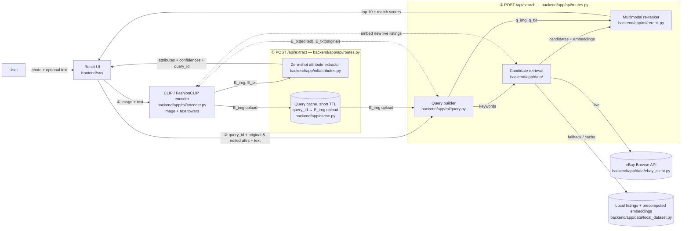

# Architecture — Thrift Searcher (v1)

This document is the v1 architecture per Sprint 1 task S1-10. It will be refined
in Sprint 3 (S3-10) once the ML and data modules are integrated. The authoritative
diagram is also embedded in `docs/PHASE2_SPRINT_PLAN.md` §4.2; keep the two in sync.

## System diagram

## Components

| Component | Path | Owner | Status (Nov 3) |
|---|---|---|---|
| React UI | `frontend/src/` | D | Done (S1-9 merged) |
| FastAPI app | `backend/app/main.py` | C | Done (this PR) |
| API contract (schemas) | `backend/app/schemas.py` ↔ `frontend/src/api/types.ts` | C + D | Done (this PR) |
| Encoder (CLIP / FashionCLIP) | `backend/app/ml/encoder.py` | A | Done (S1-5); wired into `/api/extract` in S2-1 |
| Zero-shot attribute extractor | `backend/app/ml/attributes.py` + `attributes.yaml` | A | Done (S1-5, S1-6); wired into `/api/extract` in S2-1 |
| Query builder (edit arithmetic) | `backend/app/ml/query.py` | A + B | Planned (S2-4) |
| eBay Browse client | `backend/app/data/ebay_client.py` | B | Planned (S1-1, S2-2) |
| Local dataset loader | `backend/app/data/local_dataset.py` | B | Planned (S1-2, S2-2) |
| Re-ranker | `backend/app/ml/rerank.py` | A | Planned (S2-5) |
| Embedding cache | `backend/app/cache.py` | C | Planned (S2-1) |

## Request flow

1. **`POST /api/extract`** — multipart form (`image` + optional `text`). FastAPI validates size/MIME, streams the image into memory (never to disk per privacy commitment in sprint plan §4.2), calls `ml.attributes.extract_attributes(...)`, stores the query embedding in a short-lived in-memory cache keyed by a freshly generated `query_id`, and returns `ExtractResponse`.
2. **`POST /api/search`** — `SearchRequest` with `query_id` + `original_attributes` + `edited_attributes` + optional `text`. The query builder derives a text embedding from the edits (`q_img = normalize(E_img(upload) + λ · (E_txt(edited) − E_txt(original)))`), the data layer retrieves candidates (eBay live or local fallback by `DATA_SOURCE`), and the re-ranker returns up to 10 `SearchResult`s with `match_score` rescaled to 0–100.
3. **`GET /api/item/{id}`** — details for the frontend details page.
4. **`GET /api/health`** — liveness probe for CI and local smoke tests.

## Privacy & secrets

- Uploaded images are read into a `bytes` buffer and discarded after the handler returns. No disk writes, no logging of image bytes.
- `query_id` maps to an ephemeral in-memory embedding entry with a short TTL; nothing is persisted across process restarts.
- Credentials (`EBAY_CLIENT_ID`, `EBAY_CLIENT_SECRET`) come from environment variables via `backend/app/config.py` (pydantic-settings). `.env` is gitignored; `.env.example` lists the variable names only.

## Dev proxy

The Vite dev server proxies `/api/*` → `http://localhost:8000` (see `frontend/vite.config.ts`), so FastAPI does **not** need CORS middleware during development.
