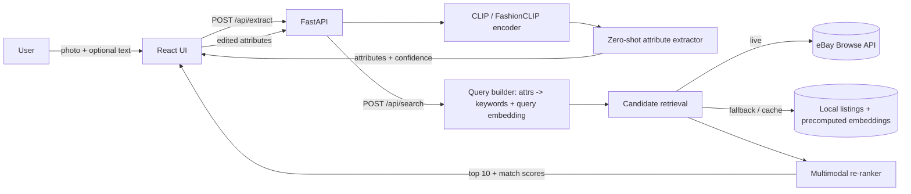
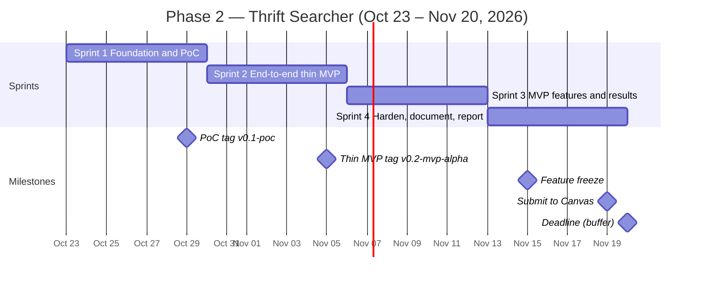

# Thrift Searcher — Phase 2 Sprint Plan

**Course:** CECS 451 Term Project · **Team:** Group 7 — Achal Mohandas, John Marquez, Quan Pham, Stephanie Noe
**Phase:** 2 — Prototype Development · **Sprint window:** Fri Oct 23 – Thu Nov 19, 2026 (4 × 1-week sprints)
**Hard deadline:** Fri Nov 20, 2026 @ 23:59 (Canvas) · **Planned submission:** Thu Nov 19 (Nov 20 = buffer day)

> **Source of truth:** `Term_project.pdf` governs every decision in this plan. Where the Phase 1 report and the
> assignment disagree, the assignment wins. Where Phase 1 and the prototype disagree, we update the docs so the
> report, repo, and demo stay consistent (the rubric gives "little or no credit" for work inconsistent with the prototype).

---

## 1. What we must deliver (from the assignment)

### Deliverable A — Technical documentation in the GitHub repository
The repo must let a grader:

| Requirement (verbatim intent) | Where we satisfy it |
|---|---|
| Install dependencies | `README.md` → Quickstart |
| Configure the system (credentials via env vars / safe method) | `.env.example`, `README.md` → Configuration |
| Run the prototype | `README.md` → Run backend + frontend |
| Reproduce a sample result | `scripts/reproduce_sample.py` + `samples/` + expected output in README |
| Understand the main files | `README.md` → Repository map table |
| Architecture | `docs/ARCHITECTURE.md` (diagram + component descriptions) |
| Code explanation | `docs/ARCHITECTURE.md`, `docs/AI_MODEL.md`, module docstrings |
| Known limitations | `README.md` → Limitations; `docs/AI_MODEL.md` |
| If an external AI model/API is used: prompts/API workflow, input-output behavior, limitations, **team's own technical contribution** | `docs/AI_MODEL.md` |

### Deliverable B — Prototype Progress Report (max 2 pages, must include GitHub URL)
Required contents: project objective and current scope · completed features · system architecture or workflow
diagram · data and model/algorithm used · preliminary output or results · known limitations · remaining tasks ·
each member's current responsibility. Must also show team members and project title. *It is not a second proposal.*

### Technical requirements
- Build a **PoC** (verify core technical feasibility), then extend it toward an **MVP with a working end-to-end user flow**.
- Implement **at least one AI model or algorithm**.
- **No passwords, API keys, private data, or secrets** in the report or the repository.

### Phase 2 checklist (our acceptance test)
A grader can **(1)** run or inspect the prototype, **(2)** understand the architecture, **(3)** see what was
implemented, and **(4)** distinguish completed work from planned work.

### Rubric — 30 points

| Item | Pts | How this plan earns it |
|---|---|---|
| Technical implementation and depth | 9 | Full stack (React → FastAPI → CLIP → retrieval → re-rank), tests, clean module boundaries |
| AI/model/LLM integration | 8 | CLIP/FashionCLIP attribute extraction + multimodal re-ranking with attribute-edit embedding arithmetic |
| Working PoC-to-MVP progression | 7 | PoC tagged end of Sprint 1, thin MVP end of Sprint 2, full MVP end of Sprint 3; tags + changelog show the progression |
| Documentation and reproducibility | 4 | Fresh-clone test by a non-author; one-command sample reproduction |
| Creativity and design decisions | 2 | Documented design decisions (Section 4.3) with rationale |

### Late policy (for risk awareness)
Up to 1 week late = 20% penalty; more than 1 week late (after Nov 27) = not accepted. We plan to submit a day early.

---

## 2. Scope for Phase 2 (from Phase 1, prioritized)

Phase 1 MVP: web app; photo and/or text search for **outerwear**; attribute extraction; attribute modification
(color, fabric, fit, style e.g. hood); top-10 ranked matches with match scores; Pinterest-style board.

| Priority | Feature |
|---|---|
| **Must** | Image upload with optional text description |
| **Must** | AI attribute extraction for outerwear: category, color, plus at least two of fabric / fit / hood (with confidence) |
| **Must** | User edits attributes (e.g., black → brown, remove hood) |
| **Must** | Candidate retrieval (eBay Browse API **or** licensed fallback dataset) + CLIP re-ranking |
| **Must** | Top-10 results with match score, price, image, and link to original listing |
| **Must** | Repo documentation meeting every item in Deliverable A; credentials via env vars |
| **Must** | Preliminary results on 15–20 test queries (needed for the progress report) |
| **Should** | Pinterest/polaroid board: details on frame, hover-to-blur detail overlay, click → details page |
| **Should** | Live eBay data (vs. fallback only); text-only search |
| **Should** | FashionCLIP vs. base CLIP comparison |
| **Could** | Linear-probe / light fine-tune of attribute heads; FAISS index; multiple marketplaces; hosted demo |
| **Won't (Phase 2)** | User accounts, saved boards, non-outerwear categories, affiliate links, mobile app |

**Consistency note:** Phase 1 lists a "fine-tuned CLIP" in the AI plan but a "pretrained CLIP" in the technical
approach. Decision: use **FashionCLIP** (a CLIP model already fine-tuned on fashion data) as the primary model, with
base CLIP as a baseline. A team-trained linear probe is a *Could*. The progress report must state this explicitly.

---

## 3. Team roles (placeholders — assign names at Sprint 1 planning)

| Role | Owns | Docs owned |
|---|---|---|
| **Member A — ML Lead** | CLIP/FashionCLIP loading, zero-shot attribute extraction, attribute vocabulary & prompts, embedding arithmetic, re-ranking, evaluation script | `docs/AI_MODEL.md`, `docs/EVALUATION.md` |
| **Member B — Data & Integration Lead** | eBay developer account + Browse API connector, fallback dataset (license check), preprocessing/dedup, embedding cache, attribute → keyword query rewriting | `docs/DATA.md` |
| **Member C — Backend & DevOps Lead** | Repo scaffold, FastAPI service & API contract, config/env handling, tests + CI, integration of ML/data modules, fresh-clone reproducibility | `README.md`, `docs/ARCHITECTURE.md` |
| **Member D — Frontend & Report Lead** | React (Vite) UI: upload, attribute editor, results board, details page; UX polish; progress report editor and assembly | Progress report, UI section of README |

**Rotating Scrum Master** (one week each, A→B→C→D): runs planning/review, keeps the board current, writes the
weekly status note. Everyone gets visible coordination work.

**Peer-review protection:** Every member commits under their own GitHub account, opens PRs for their own work, and
reviews at least one teammate PR per week. The instructor may use GitHub history to moderate peer ratings.

---

## 4. Technical plan

### 4.1 Stack
- **Backend:** Python 3.11, FastAPI, Uvicorn, Pydantic
- **ML:** PyTorch, Hugging Face `transformers` (FashionCLIP `patrickjohncyh/fashion-clip`; base `openai/clip-vit-base-patch32`), NumPy; FAISS optional
- **Frontend:** React + Vite (TypeScript optional), CSS grid/masonry for the board
- **Data:** eBay Browse API (OAuth client-credentials) → `data/listings.jsonl` + `data/embeddings.npy`; licensed fallback dataset
- **Tooling:** GitHub Issues + Projects board, PRs into protected `main`, GitHub Actions (lint + tests), `pytest`, `ruff`

*Verify model and dataset licenses in Sprint 1 and record them in `docs/DATA.md`.*

### 4.2 Architecture (draft — refine into `docs/ARCHITECTURE.md`)



**API contract (agree in Sprint 1, change only via PR):**
- `POST /api/extract` — multipart image and/or `text` → `{attributes: {category, color, fabric, fit, hood, ...}, confidences, query_id}`
- `POST /api/search` — `{query_id, original_attributes, edited_attributes, text}` → `{results: [{id, title, price, image_url, listing_url, source, match_score}] }` (max 10)
- `GET /api/item/{id}` — listing details for the details page
- `GET /api/health`

Uploaded images are processed in memory and never written to disk or logs (Phase 1 privacy commitment). The
`query_id` maps to a short-lived in-memory embedding cache, not the stored image.

### 4.3 AI design (our technical contribution — document in `docs/AI_MODEL.md`)
1. **Attribute extraction (AI Task 1):** zero-shot classification per attribute using prompt templates
   (e.g., "a photo of a {value} jacket") over a fixed outerwear vocabulary; pick argmax, return softmax confidence.
   Optional text input overrides or adds attributes.
2. **Attribute-edit query (AI Task 2):** compose the query embedding so edits steer the search away from the
   original look:
   `q_img = normalize(E_img(upload) + λ · (E_txt(edited attrs) − E_txt(original attrs)))`
3. **Retrieval:** edited attributes → keyword query → eBay Browse API (category-filtered to outerwear) or local set;
   preprocess (drop missing image/title, dedupe), embed, cache.
4. **Re-ranking:**
   `score(c) = w1·cos(q_img, E_img(c)) + w2·cos(q_txt, E_img(c)) + w3·cos(q_txt, E_txt(c.title))`
   Start with w = (0.5, 0.3, 0.2), λ = 1.0; tune on the evaluation set; display rescaled 0–100 match score.
5. **Baselines for preliminary results:** keyword-only search; image-only (no edit); base CLIP vs. FashionCLIP.

### 4.4 Preliminary evaluation (for the progress report; full evaluation is Phase 3)
- **Query set:** 15–20 outerwear queries (photos the team took or images we have rights to), each with an intended edit.
- **Metrics:** attribute-extraction accuracy on ~30 hand-labeled images; Precision@10 (team-judged relevance);
  edit-satisfaction rate (share of top 10 matching the edited attribute, e.g., color = brown); median latency.
- **Comparisons:** image-only vs. image + text/edit; keyword baseline vs. ours.
- **Failure log:** 3–5 representative failures with screenshots for the limitations section.

### 4.5 Repository layout (target)
```
thrift-finder/
├── README.md                 # overview, quickstart, config, run, reproduce, repo map, status, limitations
├── .env.example              # EBAY_CLIENT_ID=, EBAY_CLIENT_SECRET=, DATA_SOURCE=ebay|local, MODEL_NAME=
├── backend/
│   ├── app/main.py           # FastAPI routes
│   ├── app/ml/               # encoder.py, attributes.py, rerank.py
│   ├── app/data/             # ebay_client.py, local_dataset.py, preprocess.py
│   └── tests/
├── frontend/                 # React + Vite app
├── scripts/                  # ingest.py, build_embeddings.py, reproduce_sample.py, evaluate.py
├── samples/                  # 3 team-owned sample query images + expected_output.json
├── data/                     # gitignored except a small README and tiny sample set
└── docs/                     # ARCHITECTURE.md, AI_MODEL.md, DATA.md, EVALUATION.md, PHASE2_SPRINT_PLAN.md
```

---

## 5. Sprint schedule



**Cadence**
- **Sprint planning:** Friday (30–45 min) — pick backlog items, assign owners, confirm sprint goal.
- **Async standups:** Mon / Wed / Fri in the team chat — *done / doing / blocked*.
- **Mid-sprint sync:** Tuesday (15 min) — integration check.
- **Sprint review + retro:** Thursday (45 min) — demo working software on `main`, update the feature-status table, note one improvement.

> We are starting ~1 week later than the Phase 1 milestone plan (Oct 17). Sprint 1 compresses that setup work, so
> the eBay key application and fallback-dataset decision must happen in the first two days.

### Sprint 1 — Foundation & PoC (Fri Oct 23 – Thu Oct 29)
**Goal:** Prove the core technical idea works: a photo in → attributes out → nearest outerwear listings from a small local set.

| ID | Task | Owner | Done when |
|---|---|---|---|
| S1-1 | Register eBay Developer account, request keys, test OAuth in sandbox/production | B | Token obtained, or blocker documented by Oct 25 |
| S1-2 | Select fallback dataset, verify license, download outerwear subset (~300–500 items) | B | License recorded in `docs/DATA.md` |
| S1-3 | Repo scaffold (layout above), `.gitignore`, `.env.example`, branch protection, PR template, Projects board | C | `main` protected; board populated |
| S1-4 | Agree on API contract (Section 4.2) as Pydantic schemas | C + D + A | Schemas merged |
| S1-5 | Load base CLIP and FashionCLIP; zero-shot attribute notebook on 20 images | A | Accuracy per attribute recorded |
| S1-6 | Define outerwear attribute vocabulary + prompt templates | A | `attributes.yaml` merged |
| S1-7 | PoC script: image → attributes → top-k cosine from local embeddings | A + B | Runs from CLI on sample image |
| S1-8 | FastAPI skeleton with `/api/health` + stub `/api/extract` | C | Runs locally |
| S1-9 | React + Vite skeleton: upload form calling stub endpoint | D | Upload round-trips to stub |
| S1-10 | Architecture diagram v1 + README skeleton | C | Merged |
| S1-11 | Collect 15–20 team-owned query photos + intended edits; hand-label ~30 images | D + all | `eval/queries.csv` merged |

**Exit criteria:** PoC script demonstrated at review; tag `v0.1-poc`; eBay go/no-go decision made (live vs. fallback for the MVP).

### Sprint 2 — End-to-end thin MVP (Fri Oct 30 – Thu Nov 5)
**Goal:** A user can complete the whole flow in the browser — upload → see attributes → edit → get top 10 — even if it looks plain.

| ID | Task | Owner | Done when |
|---|---|---|---|
| S2-1 | Real `/api/extract` using the chosen model; returns attributes + confidences | A + C | Endpoint test passes |
| S2-2 | Ingestion pipeline: eBay connector (or fallback loader), preprocess, dedupe, ≥500 outerwear listings | B | `scripts/ingest.py` reproducible |
| S2-3 | `build_embeddings.py`: cache image + title embeddings | A + B | `.npy` cache builds in one command |
| S2-4 | Query builder: edited attrs → keywords + query embedding (edit arithmetic) | A + B | Unit-tested |
| S2-5 | `/api/search` with v1 re-ranker, returns ≤10 results with scores | C + A | Endpoint test passes |
| S2-6 | UI: attribute editor (chips/dropdowns) wired to `/api/search` | D | Edits change results |
| S2-7 | UI: basic results grid (image, title, price, score, link) | D | Links open original listing |
| S2-8 | Secrets handled only via env vars; secret scan in CI | C | CI green; no keys in history |
| S2-9 | Unit tests for attributes, query builder, rerank | A, B | `pytest` passes in CI |

**Exit criteria:** Live end-to-end demo at review; tag `v0.2-mvp-alpha`; screenshots saved for the report.

### Sprint 3 — MVP features & preliminary results (Fri Nov 6 – Thu Nov 12)
**Goal:** Reach the Phase 1 MVP feature set, generate preliminary results, and draft all documentation.
*(Wed Nov 11 is Veterans Day — plan around reduced availability.)*

| ID | Task | Owner | Done when |
|---|---|---|---|
| S3-1 | Tune λ and weights on eval queries; compare base CLIP vs. FashionCLIP | A | Results table in `docs/EVALUATION.md` |
| S3-2 | `scripts/evaluate.py`: attribute accuracy, P@10, edit-satisfaction, latency | A | Re-runnable; outputs CSV/Markdown |
| S3-3 | Image-only vs. image + edit vs. keyword baseline runs | A + B | Numbers recorded |
| S3-4 | Text-only search path; optional text merged into attributes | B + C | Works via UI |
| S3-5 | Pinterest/polaroid board: details on frame, hover-blur overlay, click → details page | D | Matches Phase 1 UI description |
| S3-6 | `/api/item/{id}` + details page | C + D | Navigates and back |
| S3-7 | Error handling: bad image, no results, API rate limit → fallback to cache | C + B | Friendly UI messages |
| S3-8 | Draft `docs/AI_MODEL.md` (model, prompts/vocab, scoring, I/O behavior, limitations, our contribution) | A | PR open |
| S3-9 | Draft `docs/DATA.md` (sources, license, preprocessing, privacy) | B | PR open |
| S3-10 | Draft README + `docs/ARCHITECTURE.md` (final diagram, main-files map) | C | PR open |
| S3-11 | Progress report outline + figure list (diagram, results table, screenshot) | D | Outline shared |

**Exit criteria:** All *Must* items done, *Should* items done or explicitly deferred; preliminary results available;
doc drafts open as PRs; tag `v0.3-mvp`.

### Sprint 4 — Harden, document, report, submit (Fri Nov 13 – Thu Nov 19)
**Goal:** Pass the Phase 2 checklist from a grader's point of view and submit a day early.

| Date | Task | Owner |
|---|---|---|
| Fri Nov 13 | Sprint planning; triage bugs; write `scripts/reproduce_sample.py` + `samples/expected_output.json` | C + A |
| Fri–Sun Nov 13–15 | Bug fixes and UX polish only; **feature freeze end of Sun Nov 15** | All |
| Sat Nov 14 | Progress report full draft (each owner writes their section; D assembles) | D + all |
| Mon Nov 16 | **Fresh-clone test:** a member who did *not* write the setup follows README on a clean machine; fix every gap | B or D |
| Mon Nov 16 | Finalize README feature-status table (Done / Partial / Planned) and Limitations | C |
| Tue Nov 17 | Report review against required-contents checklist + 2-page limit; insert GitHub URL | All |
| Tue Nov 17 | Secret audit: search repo history for keys; confirm `.env` is ignored | C |
| Wed Nov 18 | Rubric self-audit (Section 7); final fixes merged; README links verified | All |
| Thu Nov 19 | Tag `v1.0-phase2`; export report to PDF; **submit to Canvas**; confirm submission received | D (submits), Scrum Master verifies |
| Fri Nov 20 | Buffer only — emergency fixes; resubmit if needed before 23:59 | — |

---

## 6. Prototype Progress Report plan (≤ 2 pages)

| Section (required) | Content | Owner | Approx. length |
|---|---|---|---|
| Header | Title "Thrift Searcher", Group 7, all four names, **GitHub URL** | D | 3 lines |
| Project objective & current scope | One paragraph; outerwear-only MVP; Must/Should status; note FashionCLIP decision | D | ~6 lines |
| Completed features | Bullet list matching the README status table | C | ~8 lines |
| System architecture / workflow diagram | Compact version of Section 4.2 diagram | C | ~1/4 page |
| Data and model/algorithm used | Data source + size + license; FashionCLIP zero-shot attributes; edit arithmetic; re-rank formula | A + B | ~10 lines |
| Preliminary output or results | Small results table (attribute accuracy, P@10, edit-satisfaction; image-only vs. +edit) + one UI screenshot | A + D | ~1/4 page |
| Known limitations | 3–5 concrete items from the failure log | A | ~5 lines |
| Remaining tasks | Phase 3 items (full evaluation, ranking improvements, demo video) — clearly labeled *planned* | Scrum Master | ~5 lines |
| Each member's current responsibility | Table: name → role → current responsibility | All | 5 lines |

Rules: no cover page; no repeated Phase 1 market material (it is "not a second proposal"); keep it reusable for the
Phase 3 combined report; include an LLM tools disclosure as in Phase 1.

---

## 7. Rubric self-audit checklist (run Wed Nov 18)

- [ ] Grader can install, configure, and run from README alone (fresh-clone test passed)
- [ ] `reproduce_sample.py` output matches `samples/expected_output.json`
- [ ] README repository map explains every top-level folder and main file
- [ ] Architecture diagram is in both the repo and the report, and matches the code
- [ ] At least one AI model is implemented and its I/O behavior, prompts/vocabulary, limitations, and our own contribution are documented
- [ ] Feature-status table clearly separates **Done / Partial / Planned**
- [ ] PoC → MVP progression is visible (tags `v0.1-poc`, `v0.2-mvp-alpha`, `v0.3-mvp`, `v1.0-phase2` + CHANGELOG)
- [ ] Preliminary results include at least one comparison against a baseline
- [ ] Design decisions are explained (model choice, edit arithmetic, weights, fallback data)
- [ ] No secrets anywhere in the repo or its history; credentials via env vars
- [ ] Report ≤ 2 pages, includes GitHub URL, title, all members, and all eight required sections
- [ ] Report, repo, and Phase 1 report are consistent (or changes are explained)
- [ ] Every member has commits and reviewed PRs

---

## 8. Risk register

| Risk | Likelihood / Impact | Mitigation | Owner | Trigger |
|---|---|---|---|---|
| eBay API keys delayed or restricted | Med / High | Apply Day 1; build on fallback dataset in parallel; go/no-go Oct 29 | B | No working token by Oct 27 |
| Starting a week behind Phase 1 timeline | High / Med | Compressed Sprint 1; strict Must/Should scope | Scrum Master | Sprint 1 exit criteria missed |
| CLIP weak on fabric/fit/small details | High / Med | Limit to attributes with acceptable accuracy; show confidences; let user correct; report as limitation | A | Attribute accuracy < 60% |
| Edits (e.g., color change) don't move results | Med / High | Embedding arithmetic + text-weighted re-rank + keyword retrieval filter; tune λ | A | Edit-satisfaction < 50% |
| Front-end/back-end integration slips | Med / Med | Contract-first schemas in Sprint 1; stub endpoints; mid-sprint sync | C | Thin MVP not working by Nov 5 |
| Slow inference on laptops | Low / Med | ViT-B/32 size model; precompute listing embeddings; CPU-friendly defaults | A + C | Search > 5 s |
| Secrets leaked to GitHub | Low / High | `.env` ignored, `.env.example`, CI secret scan, PR review | C | Any scan hit → rotate keys immediately |
| Image rights for sample/eval images | Med / Med | Use team-taken photos or licensed dataset images only | D | — |
| Member availability (midterms, Nov 11 holiday) | Med / Med | Pair owners on each module; async standups; buffer day | Scrum Master | Two missed standups |
| Uneven contribution (peer-review risk) | Low / High | Visible ownership, own-account commits, weekly PR reviews | All | — |

---

## 9. Working agreements & Definition of Done

**Git workflow:** feature branches `feat/<id>-short-name` → PR into `main` → 1 approving review + CI green → squash merge.
Reference the backlog ID in the PR title (e.g., `S2-5: search endpoint v1`).

**Definition of Done (per task):** code merged to `main` · tests added or updated where applicable · CI green ·
relevant doc section updated · no secrets · demoable at sprint review · board card moved to *Done*.

**Communication:** team chat for async standups; blockers raised within 24 hours; decisions recorded as a short
entry in `docs/DECISIONS.md` (date, decision, reason).

---

## 10. Hand-off to Phase 3 (do not start in Phase 2 unless ahead of schedule)
Full evaluation on the expanded query set with failure analysis · ranking improvements · business-impact evidence ·
10-minute pitch video with live input-to-output demo · combined final report (≤ 8 pages) · individual peer reviews
(due Dec 11).
